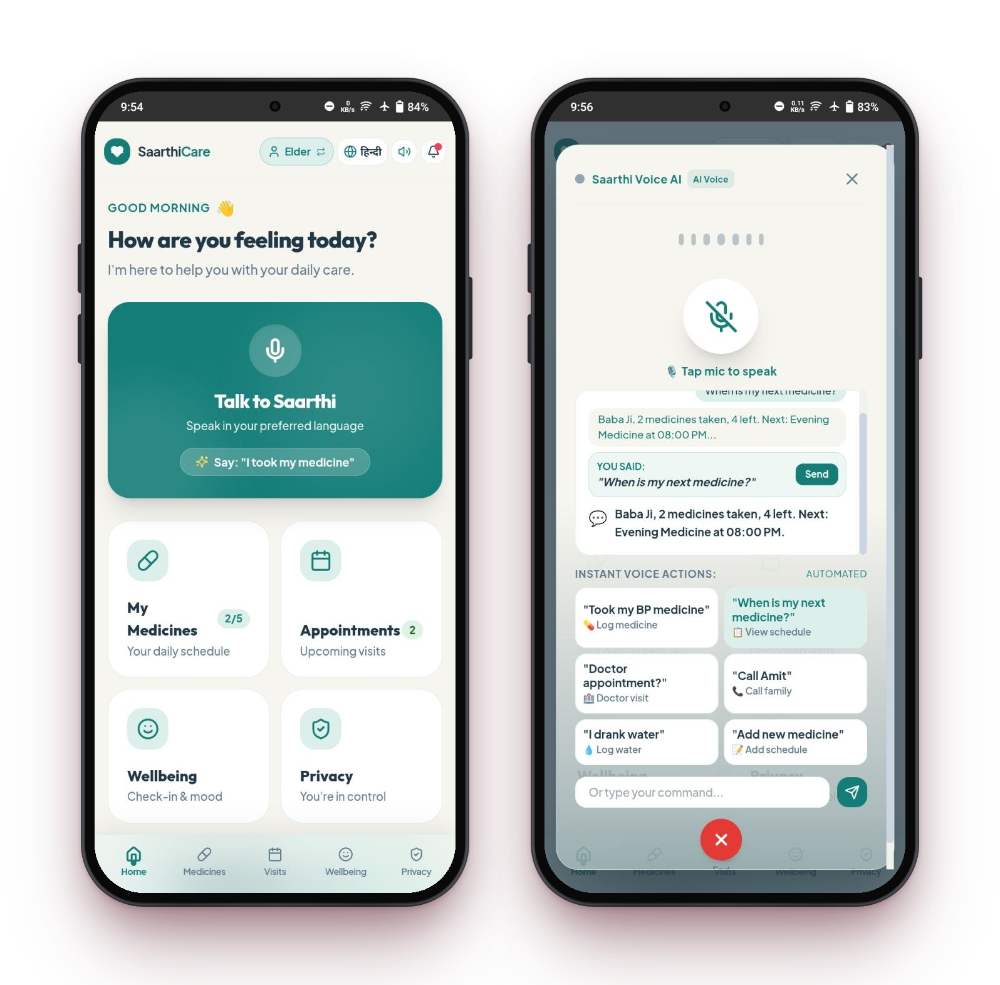
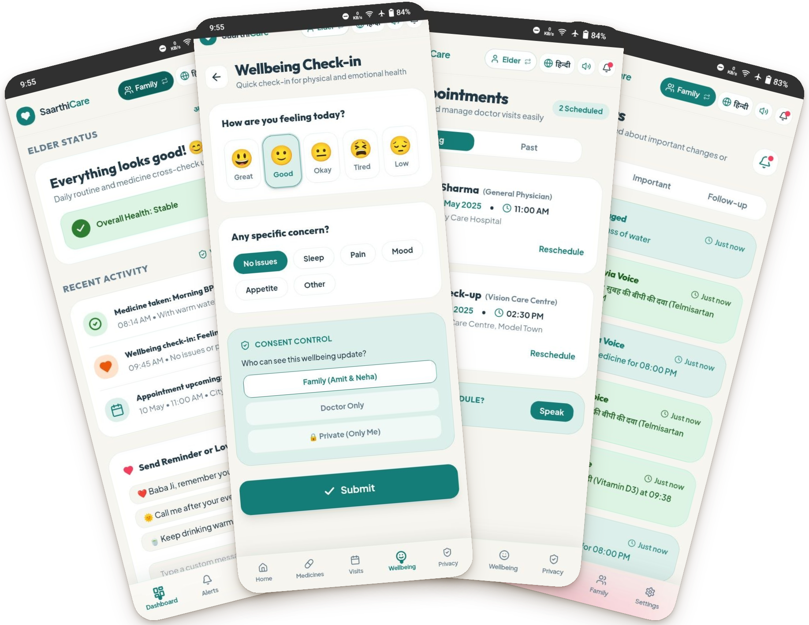

# SaarthiCare
### Care without surveillance. Assistance without taking away autonomy.

## Overview
SaarthiCare is an AI-assisted elderly healthcare and family care
coordination MVP designed to help older adults manage daily care
routines while allowing families to support them with consent.

## Problem
Older adults living independently may need help coordinating
medicines, doctor appointments, and regular wellbeing check-ins.
Family members may want updates without intrusive monitoring.

## Proposed Solution
SaarthiCare brings everyday care coordination into one accessible
experience, with an elderly-facing interface and a family-facing
dashboard.

## Features
- [Working] Elder-facing home dashboard
- [Working] Medicine coordination and reminders
- [Working] Appointment management
- [Working] Wellbeing check-ins
- [Working] Family dashboard
- [Partial] Voice assistant
- [Working / Partial / Planned] Consent and privacy controls

Update every status above to match the actual app.

## Technology Stack
- Frontend: [actual technology]
- Backend: [actual technology, if present]
- Database: [actual database, if present]
- AI / voice services: [actual services, if used]

## Screenshots

## Known Limitations
The voice assistant has some bugs and requires further testing.
Other limitations: [list only genuine limitations].

## Future Improvements
- Improve voice interaction reliability
- Expand regional-language support
- Strengthen consent controls and accessibility
- Improve testing and error handling

## Safety and Privacy
SaarthiCare is a coordination prototype, not a medical
diagnostic tool. It does not replace professional medical advice.
Only describe privacy features that are actually implemented.

## Project Status
Hackathon MVP / Prototype

## Team
Aryan Gupta
Awanish Kumar Jaiswal
